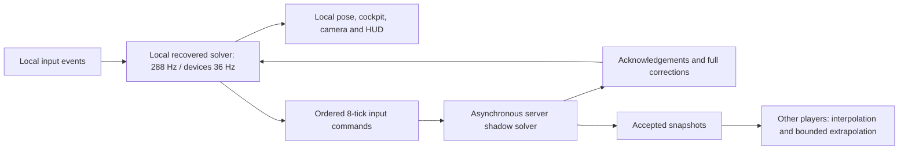

Stage 14 implementation and validation report

Implemented against the supplied V4 → V5 → RoadCourse V6 runtime sources,
including chassis type 4, tire profile 8, original Watkins Glen setups and
contacts, and 0.28 metres/stud. The supplied attachments were used as project
specification and implementation evidence. Older stage instructions were not
used to restart earlier recovery or seat-entry work. All work used one agent.

**Ownership and flow**

The local render callback samples controls at each due device boundary, advances
the complete recovered core, then presents its latest state before the camera.
It does not read the remote snapshot buffer for its own pose or cockpit draw
record. The V6 keyboard/pedal processing and all solver equations are reused.
The camera and visual correction offset never feed the physics core.

PredictionServer replaces the active Cup branch of NR2003Server. An early
return prevents the previous controller loop from running simultaneously.
The old server source is retained verbatim after that dispatcher and in the
rollback backup. Legacy non-Cup branches retain their previous behavior.

Each vehicle gets its own solver memory, epoch, command queue and vehicle ID.
The original server SeatAccess still authorizes entry/exit. Ownership changes,
reset and re-entry create fresh epochs. Traffic from an older epoch cannot
control the next driver. Both active and remote vehicles are discovered,
including dynamically completed vehicle models. Local warm instances do not
run while unowned, and removal/shutdown disconnects callbacks and clears local
presentation/physics resources.

There is an initial authoritative checkpoint transfer at ownership establishment.
Its cost is separate from ongoing input response. The primary local core is
prewarmed, and prepared cores are reused across reset/re-entry. A first cold
vehicle can still incur initialization work and checkpoint transfer delay.

**Server verification policy**

Continuous asynchronous shadow simulation was selected after measuring the full
recovered solver. Periodic verification still has to execute all intervening
nonlinear, contact-dependent ticks to provide the same authority; trusting
unverified client poses between occasional checks would weaken that guarantee.
The current implementation verifies every accepted tick once on the server.
This is deliberately a bounded-grid design pending Studio profiling.

The server accepts raw inputs only from the current seat owner and validates
finite ranges, flags, shift direction, sequence-to-tick relationships, epoch,
queue window and progress against its own elapsed clock. It limits incoming
command packets to a token bucket of 90/s and permits at most 72 ticks of lead.
Client clocks and state witnesses cannot set accepted motion. Even a fabricated
witness is compared against server-computed state; it is never imported.

Commands are held over the original eight-tick device frame. Batches contain
at most 12 commands, with retransmission from the last acknowledgement. Queues
and accepted state history are bounded to 256 frames. Missing commands pause
server validation, while the local predictor continues. Reliable control
messages carry ownership, commands, acknowledgements and checkpoints. Accepted
remote snapshots use an UnreliableRemoteEvent at up to 30 Hz. Stopped validation
does not keep publishing fresh timestamps for the same tick. Reordered/old
epoch snapshots are discarded.

Acknowledgements identify completed frames, not an intermediate tick. Both
immediate and late witnesses are compared at their actual accepted tick.
Duplicate witnesses are checked once. A correction that reaches the client
before its named tick is retained until that local tick exists. A later plain
acknowledgement cannot discard a pending correction.

Verification has a shared 12 ms callback budget and a rotating vehicle order;
no vehicle receives priority merely because it was inserted first. Individual
solver calls and checkpoint packing cannot be preempted, so an individual
callback can exceed this budget. The server also advances unoccupied cars with
the original not-driven behavior. Idle work adds cost and is not included in
the active verification budget. A driver without command traffic for three
seconds is removed from the seat. No race/lap-scoring system was added.

**Complete state restoration**

The previous checkpoint copied the entire emulated memory image, which already
contains tire relaxation/contact blocks, suspension, drivetrain, integrator
buffers, fuel/thermal/wear/damage cells, timers and RNG streams. Saving only the
45-state vector would discard required persistent state.

The audited checkpoint now also captures:

- Core integer registers, x87 stack, floating-point/control status and flags.
- Aero session settings, drafting environment and track normal.
- Runtime mode/session options and the lifted frame context registers/stack.
- Steering options, lock/rate-related host bookkeeping and telemetry state.
- FFB options, device acquisition/effect state and the last device output.
- Garage setup metadata and the selected callback set, restored into that
  instance's callback table; driver-cell bindings are refreshed from memory.
- Loaded/active track-world flags, track start and track context registers/stack.
- Adapter origin, planes/contact flags, pending shift, suspension-control gate,
  weather, physical previous pose, collision state and setup metadata.

The reset image and generated callback code remain configuration for an epoch.
Setup rebuild/reset creates a new epoch; checkpoints do not serialize function
closures. Device sinks and trace callbacks remain host connections, rather than
network state. Camera/render buffers, wheel spin presentation and visual offsets
are not physical state.

Checkpoints use lossless 1,024-byte sparse pages against the immutable epoch
baseline. The initial transfer uses a zero baseline. There are up to eight
recoverable local checkpoint slots, taken every 18 device frames (0.5 seconds),
and 256 command/state frames (about 7.1 seconds). Restoration imports the complete
authoritative checkpoint and replays subsequent stored commands in order.
Replay shares the normal local per-frame work budget; it never resamples past
inputs. Missing history causes a hard restore and a fresh epoch request.
Elapsed simulation backlog is retained through correction.

Corrections use these explicit host policy thresholds:

| Quantity | Correction threshold |
| --- | ---: |
| Chassis position norm | > 0.020 m |
| Chassis velocity norm | > 0.050 m/s |
| Largest quaternion component difference | > 0.001 |

The server also reports the unthresholded maximum difference across all 45
states. The thresholds control visible/physical correction frequency; they
were not used to weaken the deterministic equality tests. After physical
restoration, an independent visual offset can decay over 100 ms for a correction
under 2 m. Larger corrections snap. Replay cost can temporarily increase local
simulation backlog; it is not eliminated by smoothing.

**Measurements**

All numbers below were measured in the managed Linux environment using Luau
0.741, `-O2 --codegen`. They are headless measurements. There was no connected
Studio session or GPU/display/input hardware capture.

| Measurement | Result |
| --- | ---: |
| Five-run median recovered V6 solver time | 0.995357 ms/tick |
| Solver cost at 288 ticks/s, one vehicle | 28.67% of one CPU core |
| Five measured solver runs | 0.962332–1.034266 ms/tick |
| Cold core/track/setup/session initialization | 3.118 s |
| Full core memory buffer | 11,956,224 bytes |
| Initial sparse checkpoint data | 1,688,576 bytes / 1,649 pages |
| Representative correction/history delta | 100,352 bytes / 98 pages |
| Median sparse packing / restoration allocation | 8.519 / 8.712 ms |

Checkpoint sizes exclude metadata, transport framing and Roblox compression.
These results do not establish Studio bandwidth or latency. An active instance
also retains a reset image and epoch base, so its buffer-only memory floor is
roughly 34.2 MiB before generated code, tables, history and temporary copies.
Retained history packing at 2 Hz adds work and allocations; a correction adds
unpack and replay costs. Raw profiling logs include the slower measurements
observed while other checks ran concurrently.

A shadow solver therefore has a material cost. Two active validators would
consume approximately 57% of one measured core before networking, presentation,
checkpoint work and idle vehicles. Three would exceed the 12 ms/frame shared
verification budget at 60 callbacks/s on this host. Actual Roblox server/client
performance and supported grid size must be profiled in Studio. No large-grid
capacity claim is made.

In the deterministic 120 Hz host/transport test, the first control-driven local
output occurred 16.667 ms after the scheduled event with 0, 100 and 250 ms
simulated one-way network delay. The result was unchanged by delay, jitter,
every-seventh-packet loss and reordered delivery. This test uses a small solver
to isolate transport behavior. It is not a measurement of the NR2003 steering
response or input-to-photon latency. The real V6 runs separately establish exact
same-command trajectory equality in offline, predicted and validation execution.

The HUD's RTT uses an immediate ping/pong rather than the paced command-ack
interval. Backlog measures unprocessed simulation time. `event->local present`
measures a captured host event through its next sampled simulation and render
callback. Original input mathematics, device cadence, CPU backlog, render
cadence and display scanout still affect perceived response; RTT is absent
from the ongoing local simulation dependency chain.

**Tests and evidence**

| Suite | Passed | Scope |
| --- | ---: | --- |
| Stage 14 deterministic/network/checkpoint tests | 575 | Real V6 core plus isolated transport tests |
| Actual V6 adapter integration | 8 | Real adapter/core; Roblox API doubles |
| Actual client/server orchestration | 14 | Real networking modules; toy solver and transport doubles |
| Actual reversible installer | 19 | Studio DataModel/editor doubles |
| Existing Stage 10 regression | 61 | Original garage/setup vectors |
| Existing Stage 13 regression | 40 | Original FFB vectors/traces |
| Total | 717 | 0 failures |

The deterministic suite compares 576 real V6 ticks using the same indexed
commands in offline, predicted and validation runs, with exact equality of the
45-state vectors. It checks 30/60/144 FPS independence, retained backlog under
CPU budget exhaustion, nonfinite/range/tick/time rejection, acknowledgement,
loss/jitter/reordering, late witnesses, bounded history, correction replay,
independent vehicle state and lossless checkpoint encoding. A restore/replay
run matches the complete memory image exactly after changing steering options,
FFB device state and the random seed between capture and restore.

The actual adapter test makes Roblox raycasts and blockcasts throw if native
track physics queries them. It exercises native contacts, chassis selection,
render-frequency independence, full adapter restoration, local telemetry,
reset and local cleanup. It does not prove all-lap barrier parity.

The orchestration test covers two independently owned cars, local motion,
remote identity routing, ownership rejection, a deliberate divergent local
state followed by correction/replay, reset epochs, exit/re-entry, player removal,
transfer and script shutdown. The installer test covers installation, isolated
protocol smoke testing, idempotence, exact byte restoration, preserved instance
identity/server body/assets, reinstall, edited sources, damaged backups,
unsaved editors, Play refusal, operation locking and injected write recovery.
29 changed/generated runtime and installer sources also passed syntax compilation.

Actual Studio multiplayer, StreamingEnabled behavior, sustained full-lap
operation, real unreliable packet sizes under Roblox serialization, cold-start
transfer time, device/gamepad feel, cameras/meshes/seated-avatar rendering and
client/server CPU overload behavior remain unverified in the engine. Some
lifecycles are tested through API doubles rather than actual respawn physics.

**Multiplayer contact policy**

Each V6 recovered collision world currently contains its own car and the track.
Remote cars are ghosts. Their delayed/extrapolated poses are never fed into the
local contact solver. Native road/tire/barrier contacts run immediately on the
client and independently on the server. Physical divergence is corrected by
checkpoint restoration and replay.

There is no authoritative pairwise car-impact resolution in this implementation.
Contact racing remains unimplemented. Adding it requires a shared original
multicar collision world plus tick-indexed authoritative interactions, then
explicit choices about stale remote prediction and later corrections. Perfect
contact consistency under delay is not claimed. No replacement impulse law or
Roblox rigid-body car dynamics was introduced.

The existing bench-only `DamageTestImpact`/`PitTyresTest` one-shot attribute
injections are disabled during network sessions; live gameplay events need an
authoritative tick-indexed event path. Original native barrier damage and
implemented runtime systems still run. The existing car-model draw pipeline is
fed locally for the driver; this change does not add a new audio subsystem.

**Inherited physics fidelity differences**

The uploaded V6 validation already reports unresolved differences from the
original NR2003 executable. Across its pit-fast, pit-easy and concrete-fast
four-second runs, maximum sampled differences include:

| Quantity | Previously reported V6 range |
| --- | ---: |
| Chassis position | 0.000793457–0.001953125 m |
| Velocity component | 0.007010937–0.016750813 m/s |
| Engine RPM | 84.096–104.553 |
| Instantaneous tire-force component | 264.018–5001.593 N |
| Tire-force component RMS | 14.016–259.895 N |

The intermediate-precision limitation and unidentified causes of some force/RPM
errors remain. No new executable-reference run was performed here. Exact
port-versus-port replay equality establishes networking determinism for the
covered cases; it does not establish complete original-game fidelity. No tire
grip, engine power, setup calibration, scale, surface coefficients or recovered
equations was changed to achieve the networking results.
